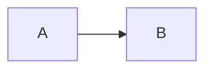

# Copy as Markdown

Plain words, **bold words**, *italic*, `inline code`, a [link](https://example.com/page)
and ~~struck~~ text.

## A list

- first item
- second item with **heavy** text
  - nested item

> A quote with *emphasis*.

| Name | Value |
|------|-------|
| alpha | 1 |
| beta | 2 |

```python
def hello():
    return "world"
```



Last paragraph.
