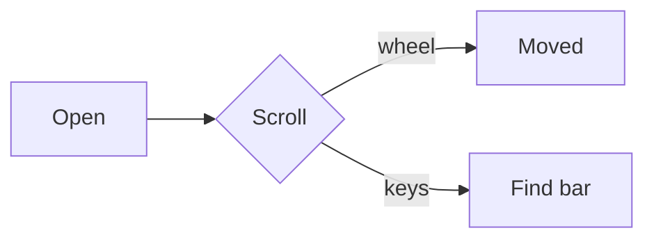

# GTK window check

This document drives `tests/linux_render/gui_check.py`: it must open in a real
window, scroll, take keys, copy to the desktop clipboard and close from its
own caption. The clipboard check looks for the marker **tinta-gtk-7Q4**.

## Mixed content

| Feature | Source | Expected |
|---|---|---|
| *Emphasis* and **strong** | inline | styled runs |
| `inline code` | backticks | Monaspace Argon chip |
| [A link](https://example.com) | inline link | accent colour |

> A quote with `code`, *emphasis* and a [link](#mixed-content) inside it.

1. Ordered item with **bold**
2. Second item
   - Nested bullet with `code`
   - Another nested bullet

```python
def greet(name: str) -> str:
    return f"hello, {name}"
```



## Filler for scrolling

Paragraph one. The wheel check needs content below the first screen, so these
paragraphs push the document past the window's height at 1000×700.

Paragraph two. Lorem ipsum dolor sit amet, consectetur adipiscing elit, sed do
eiusmod tempor incididunt ut labore et dolore magna aliqua.

Paragraph three. Ut enim ad minim veniam, quis nostrud exercitation ullamco
laboris nisi ut aliquip ex ea commodo consequat.

Paragraph four. Duis aute irure dolor in reprehenderit in voluptate velit esse
cillum dolore eu fugiat nulla pariatur.

Paragraph five. Excepteur sint occaecat cupidatat non proident, sunt in culpa
qui officia deserunt mollit anim id est laborum.

### Unicode

Mixed scripts: naïve café, Ελληνικά, Русский, 日本語のテキスト, emoji 🎨.

## End

Last line of the document.
