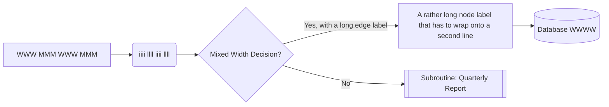
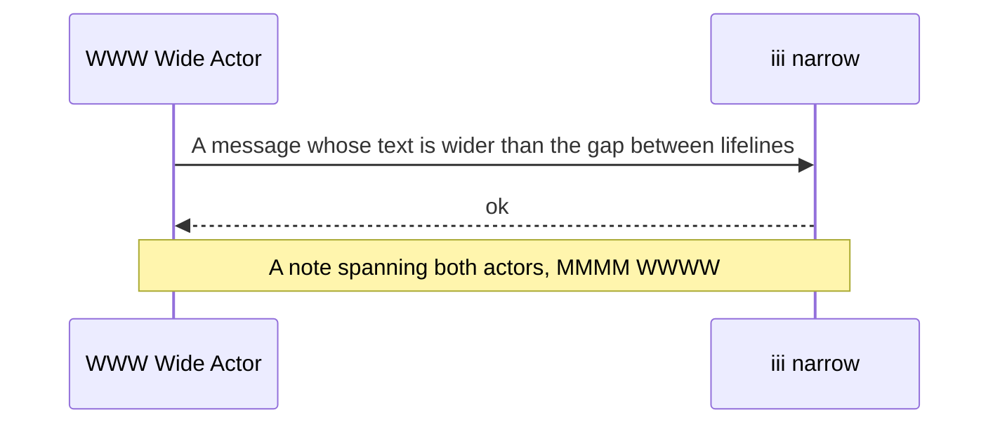
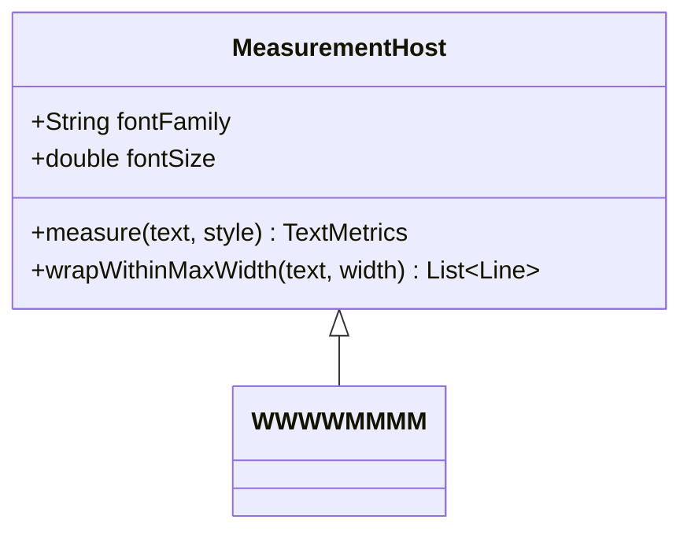
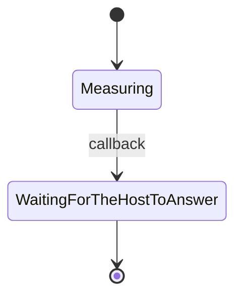

# Diagram labels fit their shapes

Mermaid sizes every node, actor and box from the width of its label. These
diagrams use labels that are **wide** (`WWW MMM`), **narrow** (`iiii llll`),
long enough to wrap, and *mixed*, so a measurement that disagrees with the
face drawing the text shows up as clipped or floating labels.

| Diagram | What to look at |
|---|---|
| Flowchart | text touching or crossing a node's border |
| Sequence | actor boxes and message text against the lifelines |
| Class | member text against the class box |
| State | state names in their rounded boxes |

## Flowchart

Text after the flowchart, with `inline code` and a [link](https://mermaid.js.org).

## Sequence

## Class

## State

> If any label above crosses its border, or sits in a box far wider than
> its text, the layout measured a different face than the one drawn.

- Themes to compare: Paper (Selawik on Linux, Segoe UI on Windows), Wombat
  (Noto Sans), and a `themes.ini` theme in a wide face such as DejaVu Sans
  or a serif.
