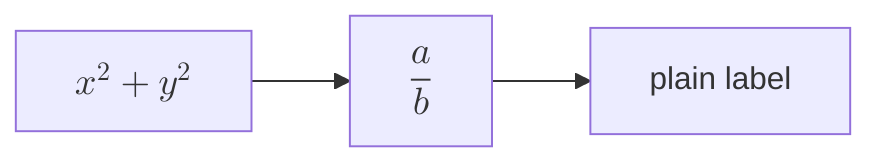

# Math in diagram labels

Formulas inside Mermaid labels render as math on both platforms: Linux
rasterizes merman's SVG with the formulas lifted in, and Windows hands that
same SVG to merman's raster (`tinta_merman_svg_to_png`).

Text after the diagram, with **emphasis** and `code`, still follows it.
