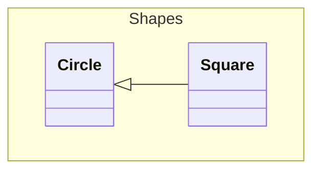

# Mermaid through merman

Every fence below renders through [merman](https://github.com/Latias94/merman)
except the last, which is not valid Mermaid. The **native** parser rejected
all of the diagrams here; see `tests/mermaid-merman-validation.md`.

| Fence | Construct | Native parser said |
|---|---|---|
| 1 | composite states, `<<choice>>`, `<<fork>>`, multi-line notes | *Multi-line notes are not supported* |
| 2 | `n@{ shape: ... }`, `A & B --> C`, `<-->`, `~~~` | *attribute syntax is not supported* |
| 3 | top-to-bottom git graph | *Only left-to-right git graphs* |
| 4 | class namespaces | *Namespaces are not supported* |
| 5 | invalid source | *code block* (both) |

> A pipeline with a choice, a fork and nested states, in a quote:
>
> ```mermaid
> stateDiagram-v2
>     [*] --> configure
>     state skipLoad <<choice>>
>     configure --> skipLoad
>     skipLoad --> load: regenerate
>     skipLoad --> validate: skip
>     load --> validate
>     note left of load
>         Fallback path builds
>         mock data from replicas
>     end note
>     state split <<fork>>
>     validate --> split
>     split --> TypeA
>     split --> TypeB
>     state TypeA {
>         [*] --> marketA1
>         [*] --> marketA2
>         marketA1 --> finalizeA
>         marketA2 --> finalizeA
>         finalizeA --> [*]
>     }
>     state TypeB {
>         [*] --> marketB1
>         marketB1 --> finalizeB
>         finalizeB --> [*]
>     }
>     TypeA --> report
>     TypeB --> report
>     report --> [*]
> ```

1. Mermaid 11 flowchart syntax, in a list item:

   ```mermaid
   flowchart LR
     db@{ shape: cyl, label: "Store" }
     api & cli --> db
     db <--> cache
     cache ~~~ note
   ```

2. A top-to-bottom git graph:

   ```mermaid
   gitGraph TB:
     commit
     branch feature
     commit
     checkout main
     merge feature
   ```

Class namespaces with `code` and *emphasis* around them:



```mermaid
flowchart LR
  A -->
```
