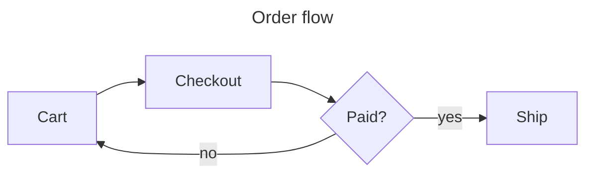
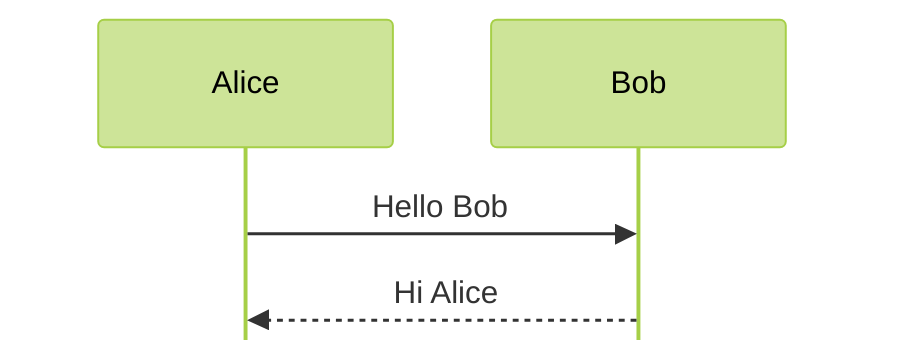
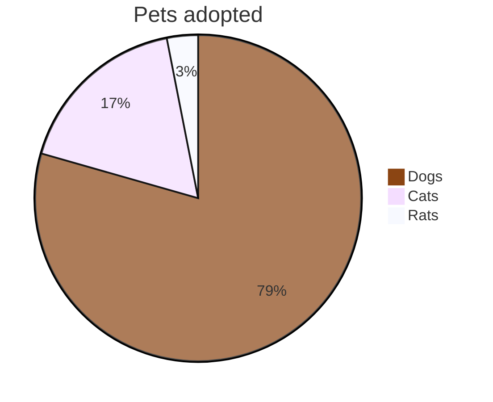
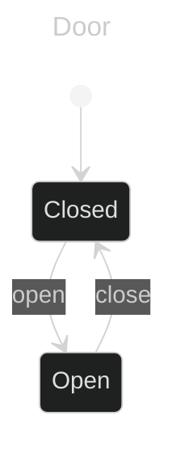
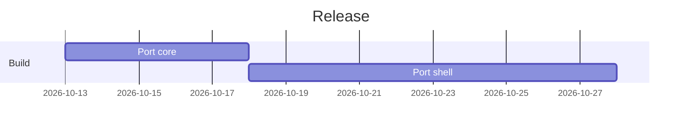
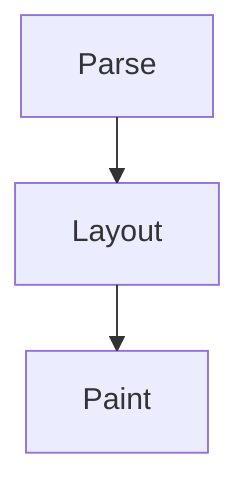

# Mermaid fences with frontmatter and directives

Mermaid's own documentation opens many diagrams with a **YAML frontmatter**
block (`title`, `config`) or an `%%{init}%%` directive. Each fence below must
render as a diagram, except the last one, whose frontmatter never closes.
See the [Mermaid syntax reference](https://mermaid.js.org/intro/syntax-reference.html).

| Fence | Preamble | Expected |
|---|---|---|
| 1 | frontmatter `title` | flowchart |
| 2 | nested frontmatter `config` | sequence |
| 3 | multi-line `%%{ }%%` directive | pie |
| 4 | frontmatter + one-line directive | state |
| 5 | frontmatter `title` | gantt |
| 6 | none, `flowchart-elk` header | flowchart |
| 7 | frontmatter, inside a quote | class |
| 8 | frontmatter, inside a list item | ER |
| 9 | unclosed frontmatter | *code block* |

A plain code block keeps its `---` lines as text:

```yaml
---
title: not a diagram
---
```













> A quoted diagram still renders, with *emphasis* around it:
>
> ```mermaid
> ---
> title: Animals
> ---
> classDiagram
>   Animal <|-- Duck
>   Animal : +int age
> ```

1. A diagram inside a list item:

   ```mermaid
   ---
   title: Orders
   ---
   erDiagram
     CUSTOMER ||--o{ ORDER : places
   ```

2. The next fence must stay a code block.

```mermaid
---
title: never closed
flowchart LR
  A --> B
```
