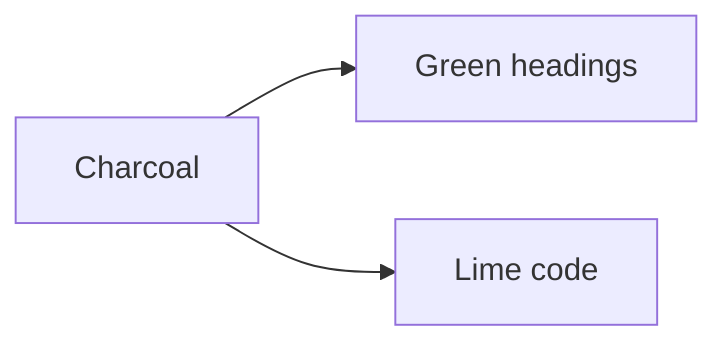

# Wombat theme

Body text in Noto Sans on charcoal, headings in **Noto Sans Display**, code in
MonoLisa (Monaspace Argon where MonoLisa is not installed). This line has
==a highlighted phrase==, `inline code`, *emphasis* and a [link](#tables).

## Code and syntax

```python
import os

def count_lines(path: str) -> int:
    """Counts the lines in a file."""
    if not os.path.exists(path):  # missing files count as empty
        return 0
    with open(path) as f:
        return sum(1 for _ in f)
```

```javascript
const items = [1, 2, 3].map((n) => n * 2);
for (const item of items) {
  if (item > 2) console.log(`item ${item}`);
}
```

```rust
fn main() {
    let total: u32 = (1..=10).filter(|n| n % 2 == 0).sum();
    println!("{}", total);
}
```

### Tables

| Role | Color | Sample |
|---|---|---|
| Heading | green | ==marked== |
| Link | sky blue | [docs](#code-and-syntax) |
| Inline code | string green | `let x = 1` |

#### Quotes and lists

> A quote with `code`, ==a mark== and **bold** text inside the left border.

1. First with `code`
2. Second with ==a mark==
   - Nested bullet with a [link](#wombat-theme)



Last line.
